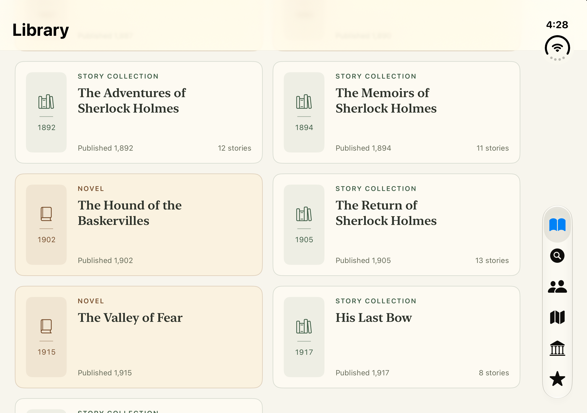
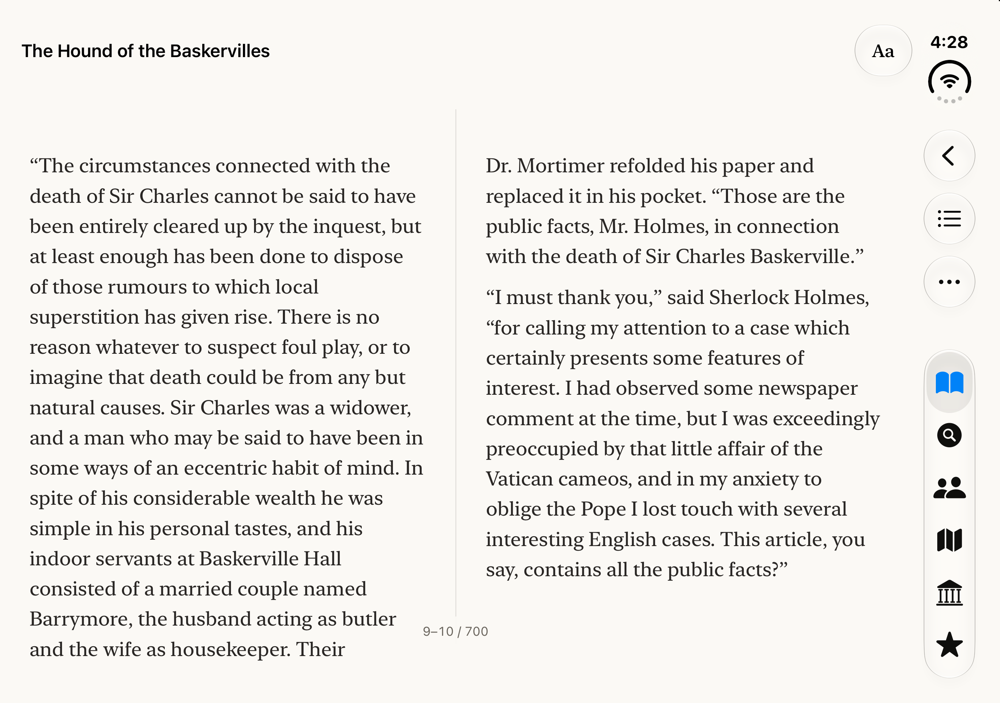
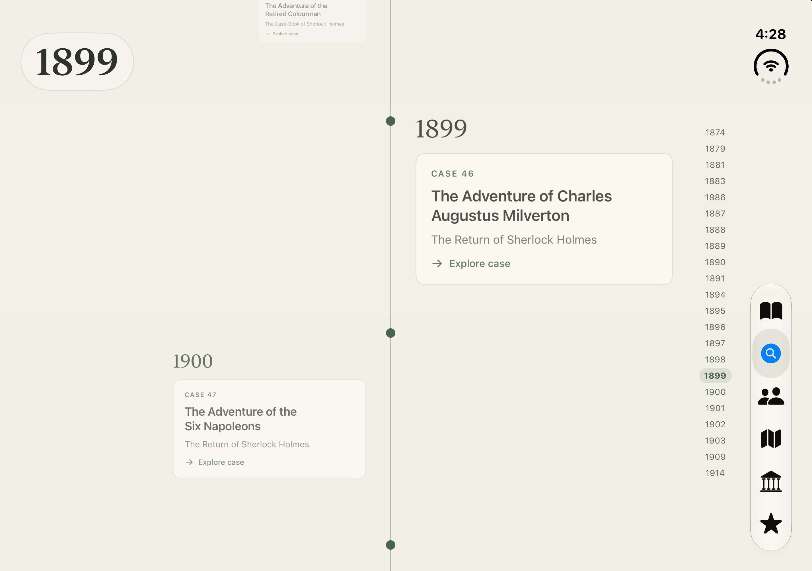

# 221B

A Sherlock Holmes companion app for exploring Arthur Conan Doyle’s stories, characters, and places. Browse the canon, follow cases through a chronology, and read the original English texts in an integrated reader.

## Screenshots

### Library
Browse novels and story collections by publication date.

### Reader
Read the original stories in a paginated layout.

### Case chronology
Explore cases along a timeline.

## Features

- Browse novels, collections, and individual stories in the library.
- Explore cases chronologically, and discover characters and locations.
- Read bundled English texts and keep track of favorites, bookmarks, and reading progress in My 221B.
- Visit the Sherlock Holmes Museum website from within the app.

## Getting started

1. Open `221B.xcodeproj` in Xcode.
2. Select the **221B** scheme and a supported simulator or device.
3. Build and run the app. For a physical device, select your own signing team in the target’s signing settings.

The project is written in Swift and SwiftUI. Its configured deployment targets include iOS/iPadOS 26.0 and visionOS 27.0.

## Text sources

The bundled English texts are derived from Project Gutenberg editions. See [OriginalTexts/README.md](OriginalTexts/README.md) for the source editions, manifest, and reuse information.
